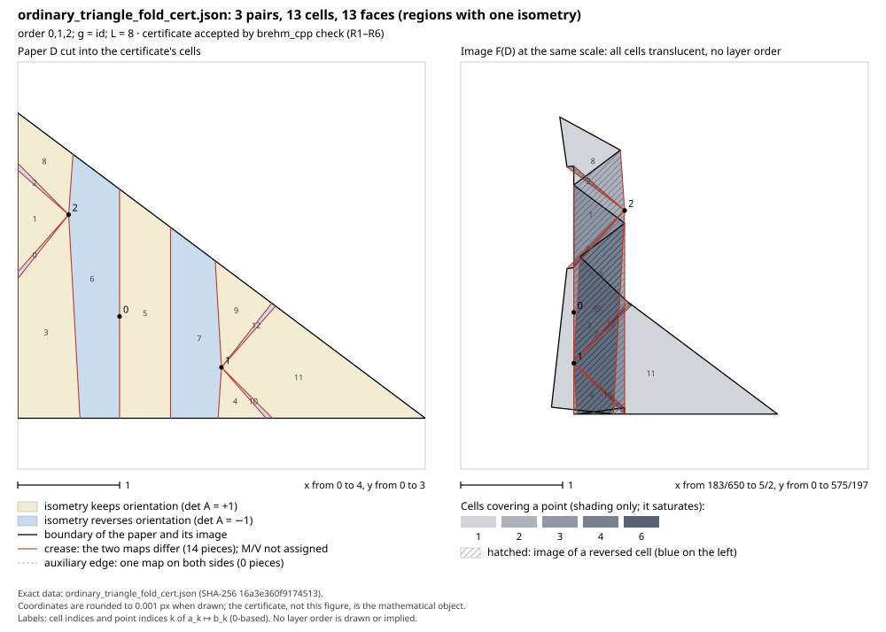
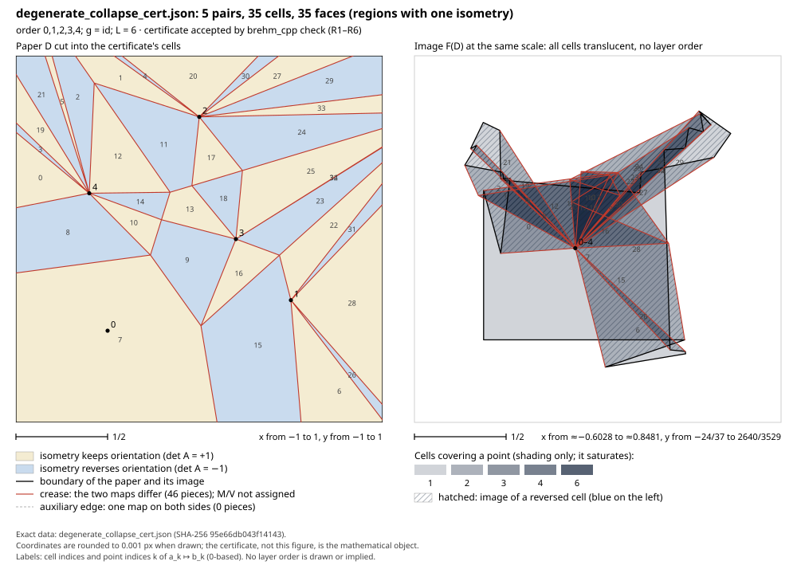

# brehm_cpp

Exact construction of Brehm's piecewise-congruent extension of a planar short map, with
independent certification. Given a convex rational polygon `D` and pairs `a_i ↦ b_i` with
`|b_i − b_j| ≤ |a_i − a_j|`, it outputs a finite list of convex cells, each with an isometry, that
forms a continuous distance-reducing map `D → R²` sending every `a_i` to `b_i`. All arithmetic is
exact (GMP rationals). Brehm's construction (U. Brehm, *Extensions of distance reducing mappings to
piecewise congruent mappings on R^m*, J. Geom. 16 (1981) 187–193,
[doi:10.1007/BF01917587](https://doi.org/10.1007/BF01917587)) leaves three choices free: the
insertion order, the initial isometry `g` and the fold threshold `L` (the protected square has half-width `3L`). All three
are options, and the output depends on all three.

What the output is, what a certificate asserts, how each checker proves it, and what is and is not
proved are in [docs/SPEC.md](docs/SPEC.md).

Author: Vanshdeep Sehrawat. License: MIT ([LICENSE](LICENSE)). Citation: [CITATION.cff](CITATION.cff).

## Extension, not folding

The output is a mathematical extension. Read as a crease pattern it satisfies Kawasaki's condition
at every interior vertex, but this software does not decide whether it has a flat folded state (a
layer order). Do not use an output as an origami crease pattern without deciding that separately.

## Build and install

Needs a C++17 compiler, CMake ≥ 3.16 and GMP with its C++ interface (gmpxx). Python ≥ 3.11 (standard
library only) runs the checkers and the tests. Install Git before cloning.

```
git clone https://github.com/vanshsehrawat14/brehm-geometry.git
cd brehm-geometry

# Debian / Ubuntu
sudo apt update
sudo apt install git build-essential cmake libgmp-dev python3
# macOS: install Xcode command-line tools, then brew install cmake gmp python
# and add -DCMAKE_PREFIX_PATH=$(brew --prefix gmp) to the configure command
cmake -S . -B build -DCMAKE_BUILD_TYPE=Release
cmake --build build
ctest --test-dir build --output-on-failure  # 10 tests
cmake --install build --prefix ~/.local

# Windows (vcpkg)
vcpkg install gmp:x64-windows
cmake -S . -B build -DCMAKE_TOOLCHAIN_FILE=<vcpkg>/scripts/buildsystems/vcpkg.cmake -DGMP_LIBRARY=<vcpkg>/installed/x64-windows/lib/gmp.lib -DGMPXX_LIBRARY=<vcpkg>/installed/x64-windows/lib/gmpxx.lib
cmake --build build --config Release
ctest --test-dir build -C Release
cmake --install build --config Release --prefix <dir>   # also installs the GMP DLLs
```

`-DBREHM_SANITIZE=ON` builds with AddressSanitizer (and UBSan outside MSVC). On Windows, keep the
source and build directories in a short path: MSBuild fails on paths longer than 260 characters.
The explicit Windows library paths select the release GMP DLLs for installation.
Keep `~/.local/bin` on PATH after a Linux/macOS install. The Python tools run from this source
checkout; CMake installs the C++ executable and Windows DLLs. Use `python3` on Linux/macOS and
`python` on Windows. The validation status of this candidate is in
[docs/VALIDATION.md](docs/VALIDATION.md).

## Use

```
brehm_cpp construct INSTANCE.json CERT.json [--steps]
brehm_cpp check CERT.json
python3 tools/ref_check.py CERT.json [--instance INSTANCE.json]     # independent checker, stdlib only
python3 tools/brehm_eval.py CERT.json [--instance INSTANCE.json]    # agreement with Brehm's map at every cell vertex
python3 tools/brehm_figure.py CERT.json FIGURE.svg [--exe EXE]      # a figure of the certificate, after brehm_cpp check
```

`construct` prints a JSON summary (cells, `max_bits`, `L`, cell counts per step, seconds).
`display_cells` counts the cells on the paper; `full_counts` counts cells on the protected square
after each insertion. `--steps` also computes `display_counts`, the per-step counts on the paper. With `--instance`, the Python tools also check that the certificate answers that instance:
its paper and pairs (`ref_check`) and its pairs, order, `g` and `L` (`brehm_eval`).

**Instance:**

```json
{
  "domain": [
    [
      "-2",
      "-2"
    ],
    [
      "2",
      "-2"
    ],
    [
      "2",
      "2"
    ],
    [
      "-2",
      "2"
    ]
  ],
  "sources": [
    [
      "-8/7",
      "2/9"
    ],
    [
      "-3/7",
      "2/9"
    ],
    [
      "1/7",
      "2/9"
    ],
    [
      "6/7",
      "2/9"
    ],
    [
      "9/7",
      "2/9"
    ]
  ],
  "targets": [
    [
      "-16/35",
      "1/7"
    ],
    [
      "-6/35",
      "1/7"
    ],
    [
      "2/35",
      "1/7"
    ],
    [
      "12/35",
      "1/7"
    ],
    [
      "18/35",
      "1/7"
    ]
  ]
}
```

`order`, `g` and `L` are optional (defaults: as listed, the identity, `L = 2·max(1, L¹ radius of D
about the first source)`). The admissible ranges are in SPEC §1. Numbers are JSON numbers or
strings holding an integer, `p/q` or a decimal (`|exponent| ≤ 1000`), read exactly; duplicate keys
are rejected (SPEC §3). Matrices are lists of rows. Write UTF-8 without a BOM.
Unknown keys are ignored; check the recorded `order`, `g` and `L` in the certificate.

**Certificate** (`brehm-rational-v1`): `domain`, `sources`, `targets`, and `pieces`, each
`{polygon, A, b}` meaning `x ↦ A x + b` on a closed convex polygon, plus a `construction` record
`{order, g, L}`.

**Exit codes** (all four tools, and `brehm_figure.py`): 0 ok; 1 certificate rejected or not Brehm's
map; 2 usage; 3 invalid input; 4 internal error or "undecided" (evaluator); 5 out of memory. Only 0 is
a positive verdict within that tool's scope. Parser and diagnostic exceptions are listed in
[docs/LIMITATIONS.md](docs/LIMITATIONS.md).

**Insertion orders.** The number of cells depends on the order in which the pairs are inserted. Two
commands search over orders, always with `g = id` and the default `L` of the first inserted source
(an `order`, `g` or `L` in the instance is ignored):

```
brehm_cpp orders-exhaustive INSTANCE.json          # the exact minimum over all orders
brehm_cpp orders-anneal INSTANCE.json ITERS SEED   # simulated annealing: a good order, no guarantee
```

Each prints one JSON line: the cell counts of the natural and the reversed order, and the best count
found with an order that gives it (`minimum`, `argmin` and the number of search `nodes`; or `best` and
`order`). The counts are those of `construct` with that order in the instance's `order`.
`orders-exhaustive` prunes partial orders, which is sound only for collapse data (all targets equal)
with every source strictly inside the paper; it refuses other data (exit 3), and its running time can
grow like `n!`. `orders-anneal` takes any data; a seed gives the same result with the same build (C++
standard libraries implement random distributions differently). Neither writes a certificate.

## Figures

`tools/brehm_figure.py` draws a certificate after `brehm_cpp check` accepts it (the executable on
`PATH`, or `--exe`). Left: the paper cut into its cells, tinted by the orientation of each cell's
isometry, with creases (the two cells' maps differ), auxiliary edges (equal maps) and the sources.
Right, at the same scale: the image of every cell and the targets. Every image cell gets the same
translucent fill, so overlaps darken with the number of cells over a point and the drawing order
cannot show: the figure draws no layer order, because a certificate has none, and mountain and
valley are not assigned. Geometry is exact; each coordinate is rounded once, to 0.001 px. Options:
`--labels`, `--highlight I,J,...` (outline cells, one colour each, in both panels), `--zoom I,J,...`
(fit both panels to some cells), `--no-points`, `--unverified` (no check; the figure says so).
`tests/figure_tests.py` recomputes every drawn element from the certificate. Tiny cells can collapse
to zero displayed area at this resolution; their exact geometry remains in the certificate. Large
SVGs can take minutes to generate and be slow to open. Use `--zoom` and `--highlight` to inspect
dense regions. The figure's validity check does not verify its displayed construction record.





## Trusting an output

What is **proved for each output** that passes the checks (SPEC §4–§6):

1. `brehm_cpp check` (boundary cancellation) and `tools/ref_check.py` (vertical slabs, pairwise
   continuity, no project imports) each verify validity conditions R1–R6. By Theorem V, a certificate
   that passes is a distance-reducing piecewise-congruent extension of its data.
2. `tools/brehm_eval.py` evaluates Brehm's map pointwise, without cells. Every value it returns is
   justified by exact tests (Lemma E3). A passing validity check **and** agreement at every vertex
   prove that the certificate *is* Brehm's map for admissible recorded choices (Theorem E2).
   The evaluator checks the starting matrix is exactly 2×2 with `gᵀg = I`, and checks its L bound.
   An evaluator pass alone does not check cell coverage, continuity or the instance's domain.
   For an instance-bound result, run both `ref_check.py --instance` and `brehm_eval.py --instance`. This needs no assumption that
   Brehm's map is affine on a cell: validity alone would not suffice (a hidden fold keeps a
   certificate valid), and the tests show the evaluator catching one.

What these proofs **assume**: Brehm's theorems as stated in SPEC §6 (B1–B3), the transcription of
his construction in SPEC §2, and that the checkers and the
evaluator do what SPEC says (unverified code with tests, below). Independent AI audits have checked
the transcription against the paper; independent human review remains outstanding. No proof of the C++ code exists.

What is **tested, not proved**: that `construct` succeeds and is correct on inputs not yet run;
evaluator termination (it can answer "undecided", exit 4, never a wrong verdict).

## Python reference

`python/core/original_brehm.py` is the reference constructor that `brehm_cpp` was ported from, line
by line, and `python/core/exact_certify.py` is a third certificate checker (areas and pairwise
clipping). Both are standard library only and much slower. `tests/run_tests.py` uses them when present:
the C++ output must equal the Python reference's on every example without construction options.

## Examples and tests

For a complete small example, run from this checkout after building (on Windows, use
`python` and `build/Release/brehm_cpp.exe`):

```
build/brehm_cpp construct examples/regression_line.json line_cert.json
build/brehm_cpp check line_cert.json
python3 tools/ref_check.py line_cert.json --instance examples/regression_line.json
python3 tools/brehm_eval.py line_cert.json --instance examples/regression_line.json
python3 tools/brehm_figure.py line_cert.json line.svg --exe build/brehm_cpp
```

All five commands should exit 0; the constructor reports 37 cells. Open `line.svg` in a browser.

`examples/` holds 31 instances, each with a `note` and an `expect`: ordinary, degenerate
(duplicates, collinear, collapse, boundary sources, `10^30` coordinates, slivers, decimals),
insertion-order comparisons, options, nine invalid inputs, and two
regression instances with stored certificates.

```
ctest --test-dir build                 # all of the following
python3 tests/run_tests.py [EXE]        # every example: exit code, three checkers, evaluator (bound to the
                                       # instance), equality with the Python reference, both regressions,
                                       # 13 mutation types, and the hidden-fold attack on four certificates
python3 tests/malformed.py [EXE]        # hostile input for all four tools: bad JSON, duplicate keys, 100,000
                                       # nested brackets, 10^999999999, 1/0, bad options; and 5,000-digit data
python3 tests/fuzz.py N SEED [EXE]      # random convex papers, degenerate sources, random order / g / L
python3 tests/figure_tests.py [EXE]     # every drawn element of the figures against the certificates
```

## Performance

The constructor's proved cell bound is `9·2^(n−1)`. A matching exponential lower bound is
not established here. Practical cost also depends on polygon degrees and rational bit lengths.

The boundary-cancellation stage of `brehm_cpp check` uses sorting/sweeping. The complete checker
also performs quadratic convexity tests per polygon and checks every source against every cell's
bounding box; it has no overall `O(E log E)` or bit-complexity guarantee. The Python checkers use
pairwise cell work and become expensive on large outputs. Tests skip the evaluator above 200 cells.

No resource limit is enforced. Allocation failures normally return exit 5, but parse-time C++
allocation failures currently return exit 3; an operating system can kill a process first.

## Limitations

* Planar `R² → R²` only. Rational data only (irrational rotations, for example, are not
  representable). The paper must be convex, bounded and inside `a_1 + [−3L, 3L]²`.
* No formal proof of the code; every output is checked instead, as above.
* The three checkers and the evaluator share an author and the certificate format (SPEC §5 lists the
  shared assumptions). An independent human review of SPEC §4–§6 is still needed.
* The independent Python tools are slow on large certificates. The evaluator may return
  undecided (exit 4); successful certification of every admissible input is not promised.
* No other published software implementation was identified in the bounded literature search.
  Private AI audits compared separately written constructors; this is not external human validation.

## Development and AI use

Developed under the author's direction with AI tools: Anthropic's Claude models, through Claude
Code, for code, tests, documentation and mathematical investigation; OpenAI Codex for code,
tests and review, including the initial `python/core/exact_certify.py` (June 2026), its July
convexity checks, and `python/core/original_brehm.py` (October 2026); and OpenAI's ChatGPT for
research planning, critical discussion and review. No independent human review has been done yet
(see Limitations).

## License

MIT ([LICENSE](LICENSE)). The repository contains no third-party code. `brehm_cpp` links against
GMP, which is not included and is distributed under LGPL-3.0-or-later or GPL-2.0-or-later; anyone
distributing binaries that bundle GMP (for example the DLLs that `cmake --install` copies on
Windows) must also meet GMP's terms. Brehm's paper is cited, not included.

## History

This repository starts with the 1.1.1 release candidate ([CHANGELOG.md](CHANGELOG.md)). Earlier development (2026)
happened in a private repository whose history is not published.
